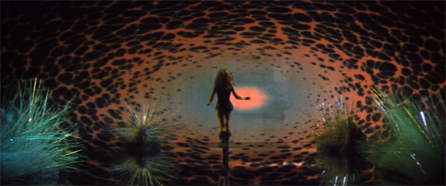

---
title: 'A Kitschy Cosmic Voyage with a “Five Star Double-Rated Astral Navigatrix”: Set Design in Roger Vadim’s Cult Space Age Film, Barbarella (1968)'
description: "From shagpile cockpits to fibre optic plants, pearl string curtains and kinetic sheet metal mosaics, the exotic spaces of Roger Vadim’s Barbarella (1968) are packed with sci-fi oddities and 1960s kitsch alike."
pubDate: 2026-03-17
updatedDate: 2026-03-17
category: "Set Decoration"
heroImage: "./cover.jpg"
---

Barbarella (Jane Fonda) and the Great Tyrant (Anita Pallenberg), surrounded by fibre-optic plants in the Chamber of Dreams. Image: Carlo Bavagnoli / The LIFE Picture Collection.

Released on 21st July 1968, exactly one year before the first human would set foot on the moon, Roger Vadim’s *Barbarella* forms part of a 1960s cinematic mode inspired by contemporaneous breakthroughs in space exploration.

Unlike Stanley Kubrick’s *2001: A Space Odyssey*, an exquisitely realistic, and for the most part technically persuasive account of an expedition through space released earlier in 1968, the French-Italian made *Barbarella* is a total intoxicating fantasy of intergalactic wayfaring, set in an unspecified, impossible future.

Opening to the sound of American soul-psych band The Glitterhouse singing, “Barbarella, psychedelia… Mmm, dazzle me with rainbow colour… Get me up high (High)”, and flaunting a visual abundance of futuristic exotica throughout, the film makes no effort to hide the influence of contemporary social and aesthetic currents, whose embeddedness within the film’s aesthetic language is certainly in part responsible for its lasting status as a cult space age classic.

Barbarella (Jane Fonda) in the projected psychedelic landscape within the Chamber of Dreams. Image: Carlo Bavagnoli / The LIFE Picture Collection.

Whilst *Barbarella* does not shine for its plot, the story nevertheless deserves recapping. Following an emergency call from the president of United Earth, which Barbarella, played by Jane Fonda, conducts naked, from the fur-lined interior of her spaceship, the softly-spoken heroine is sent on a special voyage to the icy, faraway planet of Tau Ceti, of whose extraterrestrial inhabitants United Earth knows very little. Here, she must find fellow earthling and mad scientist, Dr. Durand Durand, strip him of the perilous laser-powered weapon he has invented, and save the universe from descending into chaos and war.

Barbarella (Jane Fonda) and the Great Tyrant (Anita Pallenberg) in the Chamber of Dreams. Image: Carlo Bavagnoli / The LIFE Picture Collection.

Despite the fact that *Barbarella* is overtrusting, desperate to please, and often tactless, she eventually succeeds in her mission. Her triumph can largely be put down to her embrace of sexual encounters with foreign beings from Tau Ceti, who reward her with directions, transportation, keys, and so on. Barbarella is not, however, a lascivious character, and neither is she submissive.

On the contrary, though conducive to deception, this “Five-Star Double Rated Astral Navigatrix” is pragmatic, and, perhaps most importantly, virtuous. Ultimately, it is her good nature that saves her when the cognizant lethal liquid, the Mathmos, which acts as a guard to the Great Tyrant of Tau Ceti, played by Anita Pallenberg, forges an incorruptible bubble around her in the final scenes of the film.

Barbarella (Jane Fonda) in the shagpile cockpit of her spaceship. Image: Carlo Bavagnoli / The LIFE Picture Collection.

What *Barbarella* lacks in narrative, acting, and special effects, which, admittedly, is a lot, it makes up for in visuals. The opening scene is particularly memorable, featuring Barbarella slowly stripping off components of a chrome spacesuit as she floats in zero gravity around the fur-lined cockpit of her spaceship.

Behind her, the reproduction of a section of Georges Seurat’s pointillist painting, *A Sunday Afternoon on the Island of La Grande Jatte* (1884–86), is a hallucinatory detail whose visual incongruity adds to the psychotropic overtones of the film’s visual vocabulary, further grounding it within its late 1960s socio-historical context.

  <figure>
    
    <figcaption class="caption">Left: Barbarella (Jane Fonda) kneeling in the shagpile cockpit of her spaceship before a reproduction of George Seurat’s <em>Afternoon on the Island of La Grande Jatte</em> (1884–86) and a kinetic sheet metal mosaic panel. Image: Carlo Bavagnoli / The LIFE Picture Collection.</figcaption>
  </figure>
  <figure>
    
    <figcaption class="caption">Right: Barbarella (Jane Fonda), posing in a three-tone green, chain-link sheet metal leotard designed by Paco Rabanne. Image: Carlo Bavagnoli / The LIFE Picture Collection.</figcaption>
  </figure>

Similarly contemporary, and more consciously space age in its referencing is the scintillating mosaic wall panel at the back of the cockpit. Entirely covered in sheet metal squares that move to the voice of Barbarella’s British-accented computer companion, Alphy, the panel, no doubt, points to the sartorial futurism of Spanish-born fashion designer Paco Rabanne, whose series of chain-link quadrilateral aluminium plate dresses was released in 1964.

Rabanne, in fact, was a close supervisor of the costume design of *Barbarella*; although full credit for the shimmering intergalactic wardrobe paraded in the film must go to the lesser acknowledged Jacques Fonteray, Rabanne did design one costume entirely of his own accord.

This was the shiny, three-tone green, chain-link leotard fringed with rectangular plastic panels worn by Barbarella in the culminating scenes, with which Rabanne, unsurprisingly, reiterated his archetypically space age, signature sheet metal theme.

Later on in the film, the series of scenes shot in the eccentric underground world of Sogo, the labyrinthine, evil-ridden capital city of Tau Ceti, also pack in some extraordinary details that serve as a window onto socio-cultural preoccupations of the late 1960s.

One example, carrying connotations of hippiedom and free love, is the group of bejewelled women who lounge on animal print upholstered furnishings whilst smoking the “Essence of Man”, their pipes connected to an oversized, globular hookah within which swims a fully grown, fully nude man.

A group of women in Sogo’s underworld, lounging on animal-print upholstered furnishings whilst smoking the “Essence of Man”. Image: Carlo Bavagnoli / The LIFE Picture Collection.

Other decorative choices used for the sets of Sogo resound the sculptural, modular, and whimsical world of late 1960s interior design, itself steered by popular culture currents. The silver horned, pearl string curtain that shrouds the Great Tyrant, for example, calls to mind the chain-link mother-of-pearl disc chandeliers designed by Verner Panton in 1964, which featured in the 1969 Bond film, *On Her Majesty’s Secret Service*.

In the *Barbarella* set as in Panton’s lighting, natural materials with an organic opalescence serve to achieve the same otherworldly effects as do their counterparts in media more entrenched within a space age design vocabulary, such as the mosaic sheet aluminum used by Rabanne.

The Great Tyrant (Anita Pallenberg) standing in front of a silver horned, pearl-string curtain in the underworld of Sogo. Image: Carlo Bavagnoli / The LIFE Picture Collection.

  <figure>
    
  </figure>
  <figure>
    
  </figure>
  
Verner Panton, shell chandelier from the Fun series, 1964, as featured in Peter R. Hunt’s <em>On Her Majesty’s Secret Service</em> (1969).

On that note, the landscapes and spacescapes of *Barbarella* do not skimp on that one material visionary furniture designers of the late 1960s could never dispense with: plastic. Such details as the transparent inflatable forms over which Barbarella topples at first sight of the Great Tyrant speak to 1967 experiments in PVC inflatable furniture conducted by the likes of Paris-based Vietnamese designer Quasar Khan, or the Milan-based ‘Blow’ chair designers.

Similarly, the extravagant, indefinable furniture forms that pervade of Sogo’s underworld, rendered in fiberglass, hard and soft polyurethane, PVC, and other synthetic materials, call to mind the kinds of whimsical and, at times, conceptual domestic living proposals of utopian design groups such as Archizoom, whose ‘Safari Sofa’ of 1968 would not have looked vaguely out of place amongst the sets of *Barbarella*.

  <figure>
    
    <figcaption class="caption">Left: The Great Tyrant (Anita Pallenberg) standing in front of inflatable PVC forms in the Sogo set. Image: Carlo Bavagnoli / The LIFE Picture Collection.</figcaption>
  </figure>
  <figure>
    
    <figcaption class="caption">Right: Quasar Khanh and his family on inflatable furniture in a transparent pavilion designed by Quasar, photographed for <em>Vogue</em>, January 1970. Image: Maurice Hogenboom.</figcaption>
  </figure>

The ‘Safari Sofa’ by Florence-based Utopian architectural and design studio, Archizoom for Poltronova, 1968. Image: via Italian Design Club.

Whilst *Barbarella* and *2001: A Space Odyssey* lie on opposite ends of the space age cinematic spectrum, one dedicated to chimerical supernaturalism, the other to meticulous realism, both undeniably resonate with avant-garde furniture projects of the late 1960s which, like the films, interrogated both the nature of our living environments, and the manner in which we occupy them, in a world that looked optimistically into the future.
